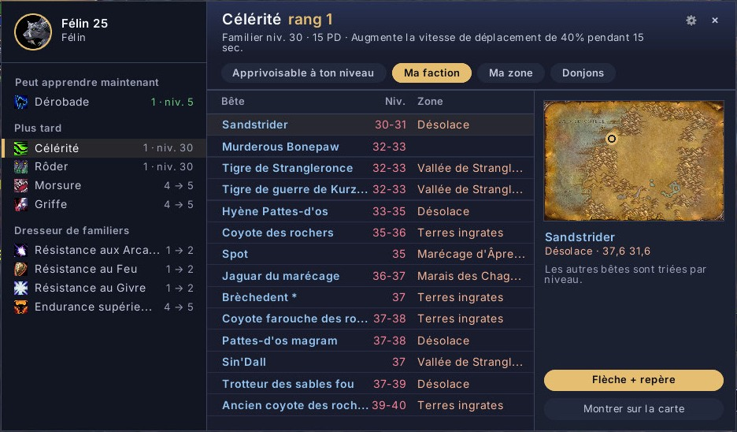
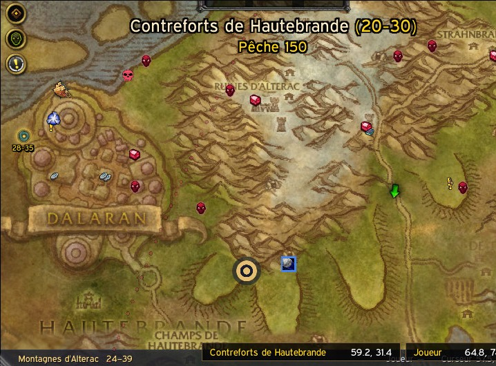
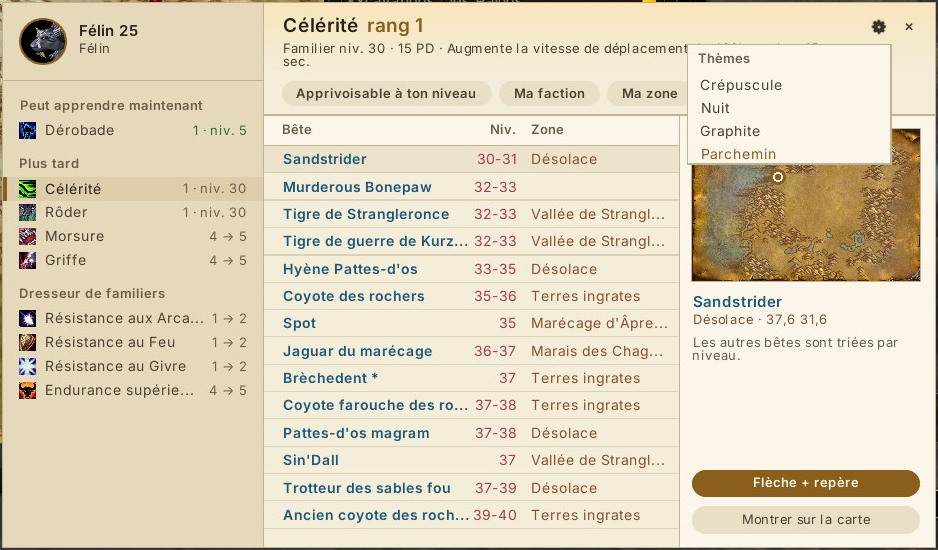

# Atlas de chasse

*English version: [README.md](README.md). En anglais, l'addon s'appelle Hunter's Atlas.*

Atlas de dressage des familiers de chasseur pour World of Warcraft : Forever 1.60.1 (`## Interface: 16001`).

L'addon reconnaît votre familier actuel, calcule les rangs de compétence qu'il peut apprendre maintenant ou plus tard, et liste toutes les bêtes qui enseignent le rang choisi, avec leur niveau, leur zone et un repère sur la carte.

| Montrer sur la carte | Thème Parchemin |
| --- | --- |
|  |  |

## Ce que fait l'addon

- **Votre familier.** Famille, niveau et sorts connus sont lus dans le jeu, par numéro de famille et numéro de sort, donc quelle que soit la langue du client.
- **Trois groupes de rangs.**
  - **Peut apprendre maintenant** : rangs que votre familier peut apprendre à son niveau actuel.
  - **Plus tard** : rangs qui demandent un niveau plus élevé, avec le niveau requis.
  - **Dresseur de familiers** : rangs vendus par le dresseur, comme Grondement, Endurance supérieure, Armure naturelle ou les résistances.
- **Les bêtes qui enseignent un rang.** Nom (en français quand il est connu), niveau (en rouge si la bête est au-dessus de votre niveau), zone et coordonnées.
- **Filtres.**
  - **Apprivoisable à ton niveau** : bêtes que vous pouvez apprivoiser maintenant.
  - **Ma faction** : masque les territoires de l'autre faction.
  - **Ma zone** : seulement la zone où vous êtes.
  - **Donjons** : ajoute les bêtes de donjon.
- **Montrer sur la carte.** Ouvre la carte du monde sur la zone de la bête et pose un point à son emplacement. Le survol donne le nom et les coordonnées, un clic droit retire le point. En combat, le jeu interdit aux addons d'ouvrir la carte : appuyez sur M, elle s'ouvre sur la bonne zone.
- **Flèche + repère.** Pose un repère dans TomTom s'il est installé, sinon avec le repère du jeu.
- **Rangs appris.** Le message « Vous avez appris… » est enregistré par personnage. L'addon indique alors que le rang est à enseigner dans Dressage des bêtes au lieu de vous envoyer apprivoiser une bête.
- **Apprentissage en jeu.** Quand vous ciblez ou survolez de près une bête qui enseigne un rang, l'addon retient son nom dans votre langue et l'endroit où vous l'avez vue. La position s'affiche ensuite avec la mention « Position vue par toi ». Quand vous apprivoisez une bête, l'addon note les rangs avec lesquels le nouveau familier arrive.
- **Onglet Ici.** Tout ce que la zone où vous êtes peut apprendre à votre familier, dans l'ordre : à apprivoiser maintenant, quand vous aurez le niveau, déjà appris. Un clic sur une carte ouvre le rang et la bête.
- **Infobulle des bêtes.** Le survol d'une bête qui enseigne un rang ajoute une ligne par rang : à apprivoiser, familier niv. X requis, trop haute pour toi, ou déjà appris.
- **Alerte.** Cibler ou survoler une bête qui enseigne un rang que votre familier peut prendre maintenant affiche un petit bandeau pendant 5 secondes, une fois par bête et par session, jamais en combat. Un clic ouvre l'atlas sur ce rang. `/atlas alerts` la coupe.
- **Sources affichées.** Chaque bête indique d'où vient son information : Vérifié (confirmé par apprivoisement), Vu en jeu, ou le site d'origine. L'onglet Ici affiche la date des données et la version de l'addon.
- **Quatre thèmes** : Crépuscule (par défaut), Nuit, Graphite, Parchemin.
- Bouton de minicarte (déplaçable) et entrée dans le menu des addons.

Sans familier sorti, la fenêtre propose de choisir une famille pour parcourir ses rangs. Sur un personnage qui n'est pas chasseur, l'addon ne fait rien.

## Installation

1. Si vous téléchargez le zip GitHub (**Code → Download ZIP**), le dossier s'appelle `AtlasDeChasse-main` : renommez-le en `AtlasDeChasse`.
2. Copiez le dossier `AtlasDeChasse` dans `World of Warcraft\_forever_\Interface\AddOns\`.
3. Quittez complètement le jeu et relancez-le : un `/reload` ne charge pas un nouveau dossier d'addon.

## Commandes

| Commande | Effet |
| --- | --- |
| `/atlas` (ou `/adc`) | ouvre ou ferme la fenêtre |
| `/atlas theme <nom>` | change de thème : `crepuscule`, `nuit`, `graphite`, `parchemin` |
| `/atlas minimap` | affiche ou masque le bouton de minicarte |
| `/atlas alerts` | active ou coupe les alertes de bêtes |
| `/atlas help` | liste des commandes |

Clic gauche sur le bouton de minicarte : ouvre la fenêtre. Clic droit : menu des thèmes.

## Données

L'addon n'a besoin d'aucun autre addon en jeu. TomTom est utilisé s'il est installé, sinon le repère de carte du jeu.

`Data/Data.lua` contient 33 compétences, 156 rangs (tous avec leur numéro de sort), 472 bêtes qui enseignent, leurs emplacements et la faction des zones. Il est généré par un outil de construction qui n'est pas publié ici, et ne doit pas être modifié à la main.

Sources, par ordre de priorité :

- **[Petopia Forever](https://www.wow-petopia.com/forever/abilities.php)** : quelles bêtes enseignent quel rang, niveaux du familier, coût en points de dressage.
- **HunterPetJournal 1.5.0** (addon) : coordonnées des bêtes, numéro de sort de chaque rang, familles et icônes.
- **[Wowhead Forever](https://www.wowhead.com/forever)** : emplacements des bêtes que les deux sources précédentes ne placent pas, vérification des rangs enseignés, et le [catalogue hunter-pets](https://www.wowhead.com/forever/hunter-pets) qu'il publie (bêtes, niveaux, rangs, points d'apparition) pour les zones que HunterPetJournal ne couvre pas.
- **[warcraft.wiki.gg](https://warcraft.wiki.gg/wiki/Zones_by_level_(original))** : territoire Alliance, Horde ou contesté de chaque zone.
- **Polestar** (`Polestar_frFR`) : noms français des bêtes.
- **Observations en jeu du mainteneur** : emplacements des bêtes qu'aucune source ne place, et rangs confirmés par apprivoisement. Elles comblent les trous sans jamais remplacer une source ; un désaccord est tranché à la main.

Les noms et textes du jeu appartiennent à Blizzard Entertainment.

La fenêtre utilise la police [Inter](https://github.com/rsms/inter), sous licence SIL Open Font License 1.1 (`Media/Fonts/Inter-OFL.txt`).

## Limites connues

- 10 bêtes n'ont pas encore d'emplacement : des PNJ propres à Forever qu'aucune source ne place (Forest Stalker, Mud Crawler, Noxious Reaver et Shredder, Vilebranch Wolf, Murderous Bonepaw, Rabid Shrike Bat, Rabid Snickerfang, Scorpok Snapper et Lasher). L'apprentissage en jeu les complète au fil des parties.
- La loyauté et les points de dressage du familier ne sont pas disponibles sur ce client : l'addon ne les affiche pas.
- La position notée en jeu est la vôtre au moment où vous ciblez la bête, à moins de 28 mètres environ.
