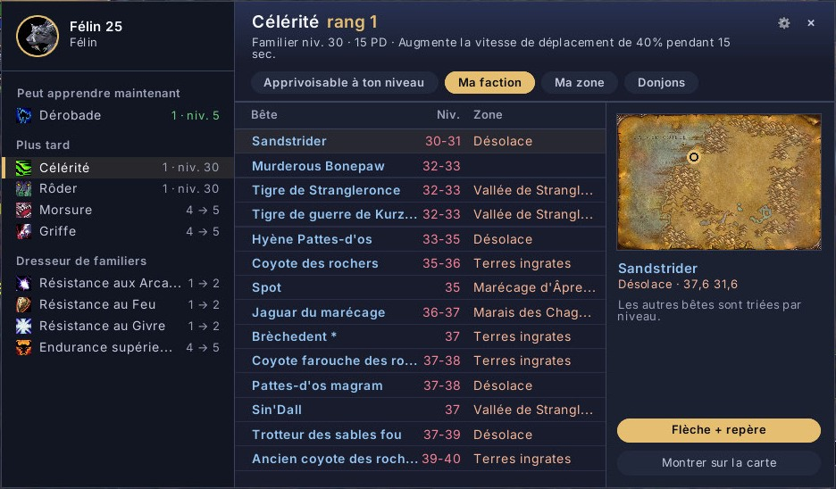
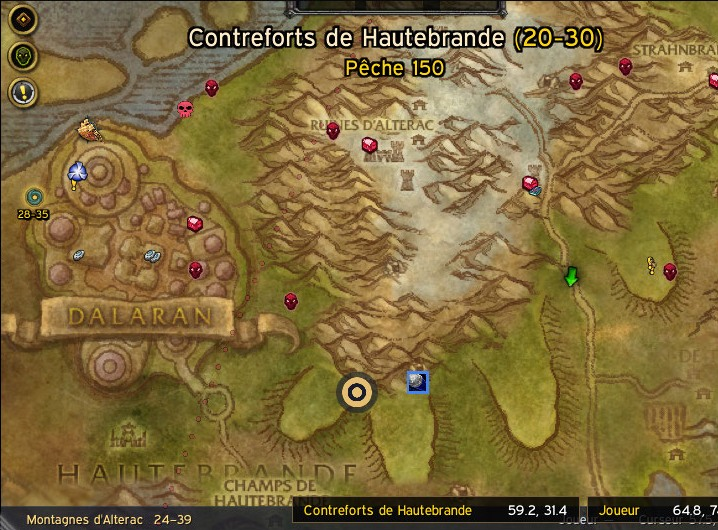
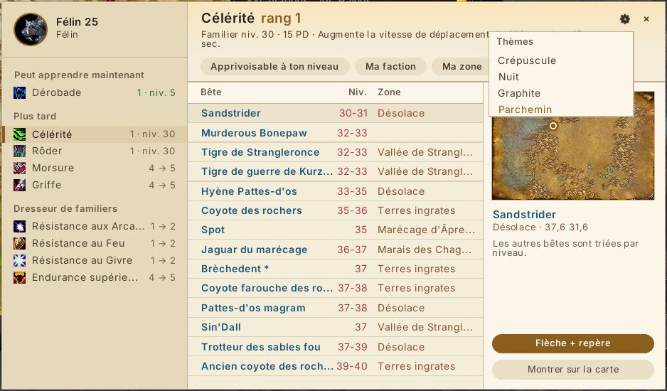

# Hunter's Atlas

*Version française : [README.fr.md](README.fr.md)*

A hunter pet-training atlas for World of Warcraft: Forever 1.60.1 (`## Interface: 16001`).

The addon recognizes your current pet, works out which ability ranks it can learn now or later, and lists every beast that teaches the chosen rank, with its level, zone and a point on the map.

The addon shows English on every client except French ones, which get French (and the name "Atlas de chasse").

| Show on map | Parchment theme |
| --- | --- |
|  |  |

*Screenshots from a French client.*

## What it does

- **Your pet.** Family, level and known spells are read from the game by family ID and spell ID, so it works whatever the client language.
- **Three groups of ranks.**
  - **Can learn now**: ranks your pet can learn at its current level.
  - **Later**: ranks that need a higher level, with the level required.
  - **Pet trainer**: ranks sold by the pet trainer, such as Growl, Great Stamina, Natural Armor or the resistances.
- **The beasts that teach a rank.** Name, level (red when the beast is above your level), zone and coordinates.
- **Filters.**
  - **Tameable at your level**: beasts you can tame right now.
  - **My faction**: hides the other faction's territories.
  - **My zone**: only the zone you are in.
  - **Dungeons**: adds dungeon beasts.
- **Show on map.** Opens the world map on the beast's zone with a point at its location. Hover it for the name and coordinates; right-click it to remove it. In combat the game does not let addons open the map: press M and it opens on the right zone.
- **Arrow + pin.** Sets a waypoint with TomTom when it is installed, otherwise with the game's own waypoint.
- **Learned ranks.** The "You have learned…" message is recorded per character. The addon then tells you to teach the rank from Beast Training instead of sending you off to tame a beast.
- **Here tab.** Everything the zone you stand in can teach your pet, in order: tame now, when you have the level, already learned. Click a card to open its rank and beast.
- **Beast tooltip.** Hovering a beast that teaches a rank adds one line per rank: tame it, pet level needed, too high for you, or already known.
- **Beast alert.** Targeting or hovering a beast that teaches a rank your pet can take now shows a small banner for 5 seconds, once per beast and per session, never in combat. Click it to open the atlas on that rank. `/atlas alerts` turns it off.
- **Sources shown.** Each beast carries where its information comes from: Verified (confirmed by taming), Seen in game, or the site it comes from. The Here tab shows the date of the data and the addon version.
- **Learns as you play.** When you target or closely hover a beast that teaches a rank, the addon remembers its name in your language and where you saw it. The position is then shown with the note "Position you saw". When you tame a beast, it notes the ranks the new pet arrives with.
- **Four themes**: Twilight (default), Night, Graphite, Parchment.
- A minimap button (draggable) and an entry in the addon compartment.

With no pet out, the window lets you pick a family to browse its ranks. On a character that is not a hunter, the addon does nothing.

## Installation

1. Download the addon. If you use GitHub's **Code → Download ZIP**, the folder inside is named `AtlasDeChasse-main`: rename it to `AtlasDeChasse`.
2. Copy the `AtlasDeChasse` folder into `World of Warcraft\_forever_\Interface\AddOns\`.
3. Quit the game completely and start it again: `/reload` does not load a new addon folder.

## Commands

| Command | Effect |
| --- | --- |
| `/atlas` (or `/adc`) | opens or closes the window |
| `/atlas theme <name>` | changes the theme: `twilight`, `night`, `graphite`, `parchment` |
| `/atlas minimap` | shows or hides the minimap button |
| `/atlas alerts` | turns the beast alerts on or off |
| `/atlas help` | lists the commands |

Left-click the minimap button to open the window. Right-click it for the theme menu.

## Data

The addon needs no other addon in game. TomTom is used when it is installed, otherwise the game's own map waypoint.

`Data/Data.lua` holds 33 abilities, 156 ranks (each with its spell ID), 439 teaching beasts, their locations and the faction of each zone. It is generated by a build tool that is not published here, and must not be edited by hand.

Sources, in order of priority:

- **[Petopia Forever](https://www.wow-petopia.com/forever/abilities.php)**: which beasts teach which rank, pet levels, training point cost.
- **HunterPetJournal 1.5.0** (addon): beast coordinates, the spell ID of each rank, families and icons.
- **[Wowhead Forever](https://www.wowhead.com/forever)**: locations of the beasts the two sources above do not place, and a check of the ranks taught.
- **[warcraft.wiki.gg](https://warcraft.wiki.gg/wiki/Zones_by_level_(original))**: Alliance, Horde or contested territory of each zone.
- **Polestar** (`Polestar_frFR`): French beast names.
- **In-game observations by the maintainer**: positions of beasts no source places, and ranks confirmed by taming. They fill gaps and never replace a source; a disagreement is reviewed by hand.

Game names and texts belong to Blizzard Entertainment.

The window uses the [Inter](https://github.com/rsms/inter) font, under the SIL Open Font License 1.1 (`Media/Fonts/Inter-OFL.txt`).

## Known limits

- 36 non-dungeon beasts have no location yet, most of them in the new Riverglades. Learning as you play fills them in over time.
- Pet loyalty and training points are not available on this client, so the addon does not show them.
- A position noted in game is your own position when you target the beast, within about 28 yards.
